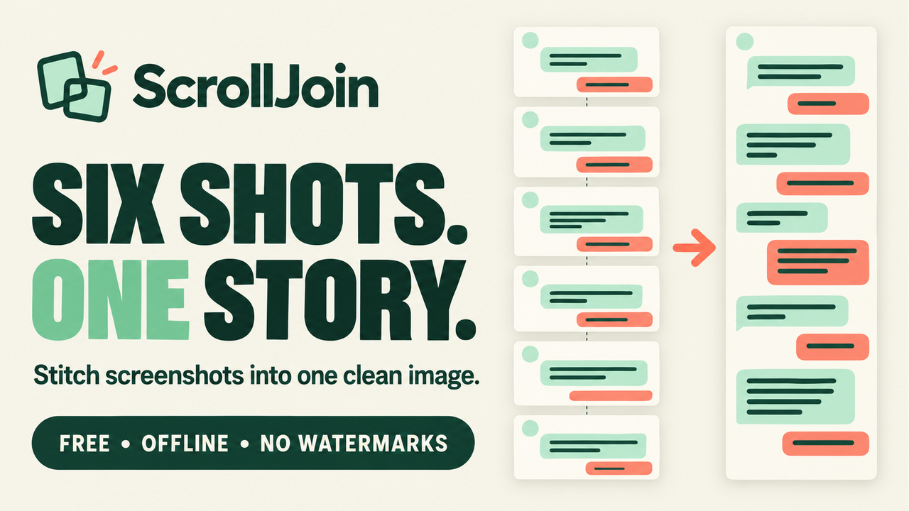

# ScrollJoin

Free offline screenshot stitcher. One HTML file. Adjustable joins, cropping, and PNG/JPG/PDF export.

Download the release ZIP, extract it, and open `ScrollJoin.html` in a current desktop browser. Click **Try the sample** to test it immediately. No installation, server or build step is required.

Features: automatic overlap suggestions between consecutive screenshots, manual join inspection with a slider or pixel value, trimming of repeated headers and bars, reordering, undo/redo, output width control, and export as one long PNG or JPG, or a PDF split across A4/Letter pages.

This version stitches vertically. Input: still PNG, JPG/JPEG and WebP. Output: PNG, JPG and image-based PDF. Automatic matching works best when consecutive screenshots overlap and use the same zoom and layout; it cannot guarantee a correct match, so review every join. PDF text is not selectable or searchable.

The editable source is inside the HTML file. Code is licensed under MIT; the full license and operating limits are included in START-HERE.txt.

Live demo: https://rsaxena3011.github.io/scrolljoin/
